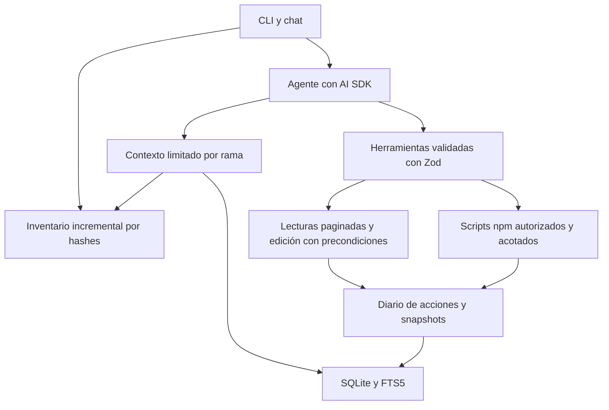

# Arquitectura de VibeKeep 0.1

## Flujo implementado

## Módulos

- `cli.ts`: comandos, conversación, configuración y ciclo de vida del bloqueo.
- `agent.ts`: adaptadores de proveedor, contexto, límites y herramientas. El modelo propone; las herramientas aplican reglas.
- `repo.ts`: enumeración Git o filesystem, paquetes, scripts, instrucciones y hashes. No ejecuta el contenido durante la adopción.
- `paths.ts`: límites de ruta, exclusiones, Git ignore y rechazo de symlinks.
- `store.ts`: eventos, decisiones, mensajes, inventarios, acciones y export/import.
- `execution.ts`: cambios de archivos con snapshots, undo y scripts con evidencia.
- `lock.ts`: un escritor CLI local por proyecto.

## Decisiones de implementación

Se usa `node:sqlite`, verificado con FTS5 en el runtime de referencia, en lugar de añadir un binding nativo externo en este primer corte. El lockfile fija la combinación de dependencias probada. El requisito mínimo de Node evita runtimes anteriores a los usados para las APIs incorporadas.

Los hechos detectados se almacenan como inventario; no se convierten en decisiones históricas del usuario. Las decisiones tienen los estados `proposed`, `accepted` y `superseded`. Solo una acción explícita del operador acepta una decisión. Una cita de conversación aporta procedencia a una propuesta, no garantiza que la interpretación del modelo sea correcta.

SQLite es el almacén local de autoridad. Una transacción aplica cambios de decisión y eventos juntos. El índice FTS permite buscar decisiones; los hashes detectan cambios del código sin tener que pedirle al modelo que relea todo.

Un evento de ejecución conserva su resultado y huella del inventario. Es evidencia del comando que se ejecutó, no una prueba general de la aplicación. Los cambios de archivos propios se registran antes de escribir; los fallos de resultado incierto no se reejecutan al cargar el proyecto.

El contexto tiene límites de mensajes, caracteres de memoria, rutas e instrucciones. Las lecturas de archivos son paginadas, las herramientas de recuperación pueden expandir contexto y el agente tiene hasta doce pasos por turno. El límite de caracteres no equivale a una garantía exacta de tokens para cada modelo. El consumo informado por el proveedor se conserva cuando está disponible.

## Límites conocidos

- Se detectan manifiestos de varios lenguajes; el entendimiento inicial es inventario y lectura dirigida, no un grafo semántico completo.
- No hay aún Tree-sitter, LSP, embeddings, XState, servidor MCP ni panel web.
- Se permite código local del proyecto únicamente mediante scripts npm declarados y autorizados. Los scripts pueden tener efectos externos; el runtime no proporciona aislamiento del sistema operativo.
- Las precondiciones de archivos no son un bloqueo transaccional frente a un editor externo. Se requieren integración más profunda o worktrees para reducir aún más esa carrera.
- La memoria por rama evita recuperar decisiones ajenas a esa rama, pero no implementa herencia automática entre ramas ni almacén compartido entre worktrees.
- No hay despliegue, instalación automática de dependencias ni administración persistente de procesos de desarrollo.
- El import rechaza conflictos en un ID existente. No intenta resolverlos con el modelo ni tratar el último archivo importado como más verdadero.

## Fuentes de las integraciones

- [AI SDK: herramientas](https://ai-sdk.dev/docs/ai-sdk-core/tools-and-tool-calling).
- [AI SDK: proveedores compatibles](https://ai-sdk.dev/providers/openai-compatible-providers).
- [Zod: contratos y validación](https://zod.dev/).
- [SQLite: FTS5](https://www.sqlite.org/fts5.html).
- [SQLite: WAL](https://www.sqlite.org/wal.html).

La implementación se valida con compilación y pruebas locales. Las propiedades de estas bibliotecas no sustituyen las comprobaciones de integración del framework.
