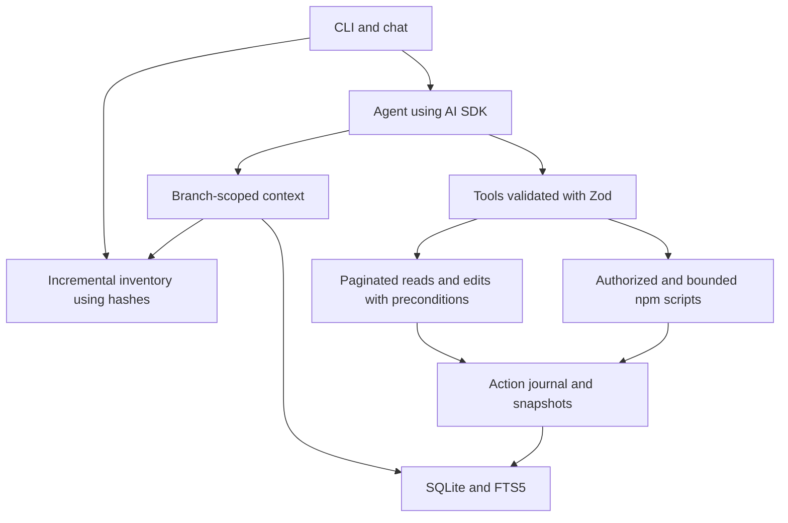

# VibeKeep 0.1 architecture

This document describes the implemented 0.1 runtime. Its current npm and local-filesystem constraints are not the intended product boundary. The [environment-agnostic architecture plan](environment-agnostic-plan.md) defines how to extract a general core and support code, design, documents, and remote or native application workspaces through adapters.

## Implemented flow

## Modules

- `cli.ts`: commands, conversation, configuration, and lock lifecycle.
- `agent.ts`: provider adapters, context, limits, and tools. The model proposes; tools enforce rules. Responses, generated documentation, and decision summaries use English.
- `repo.ts`: Git or filesystem enumeration, packages, scripts, instructions, and hashes. Adoption does not execute project contents.
- `paths.ts`: path boundaries, exclusions, Git ignore rules, and symlink rejection.
- `store.ts`: events, decisions, messages, inventories, actions, and export/import.
- `execution.ts`: file changes with snapshots, undo, and scripts with evidence.
- `lock.ts`: one local CLI writer per project.

## Implementation decisions

The first release uses `node:sqlite`, verified with FTS5 in the reference runtime, instead of adding an external native binding. The lockfile pins the tested dependency combination. The minimum Node version excludes runtimes older than those required for the built-in APIs.

Detected facts are stored as inventory; they do not become historical user decisions. Decisions have `proposed`, `accepted`, and `superseded` states. Only an explicit operator action accepts a decision. A conversation quote establishes a proposal's provenance but does not guarantee that the model's interpretation is correct.

SQLite is the authoritative local store. Transactions apply decision changes and events together. The FTS index supports decision search; hashes detect code changes without asking the model to reread everything.

Execution records preserve results and the inventory fingerprint. They provide evidence of a specific command, not a general application test. Own file changes are journaled before writing; actions with uncertain outcomes are not replayed when the project loads.

Context is bounded by message count, memory characters, paths, and instruction excerpts. File reads are paginated, retrieval tools can expand context, and the agent has up to twelve steps per turn. Character limits do not guarantee an exact token budget for every model. Provider-reported usage is preserved when available.

## Known limitations

- Manifests from several languages are detected; initial understanding consists of inventory and targeted reads, not a complete semantic graph.
- Tree-sitter, LSP, embeddings, XState, an MCP server, and a web panel are not implemented yet.
- Local project code executes only through declared and authorized npm scripts. Scripts can have external effects; the runtime does not provide operating-system isolation.
- File preconditions are not a transactional lock against external editors. Deeper integration or worktrees are needed to reduce that race further.
- Branch-scoped memory avoids retrieving decisions from other branches but does not implement automatic branch inheritance or a shared worktree store.
- Deployment, automatic dependency installation, and persistent development-process management are not implemented.
- Imports reject conflicting existing IDs. They do not ask the model to resolve conflicts or treat the last imported file as more authoritative.

## Integration references

- [AI SDK: tools](https://ai-sdk.dev/docs/ai-sdk-core/tools-and-tool-calling).
- [AI SDK: compatible providers](https://ai-sdk.dev/providers/openai-compatible-providers).
- [Zod: schemas and validation](https://zod.dev/).
- [SQLite: FTS5](https://www.sqlite.org/fts5.html).
- [SQLite: WAL](https://www.sqlite.org/wal.html).

The implementation is verified through compilation and local tests. Library capabilities do not replace framework integration checks.
