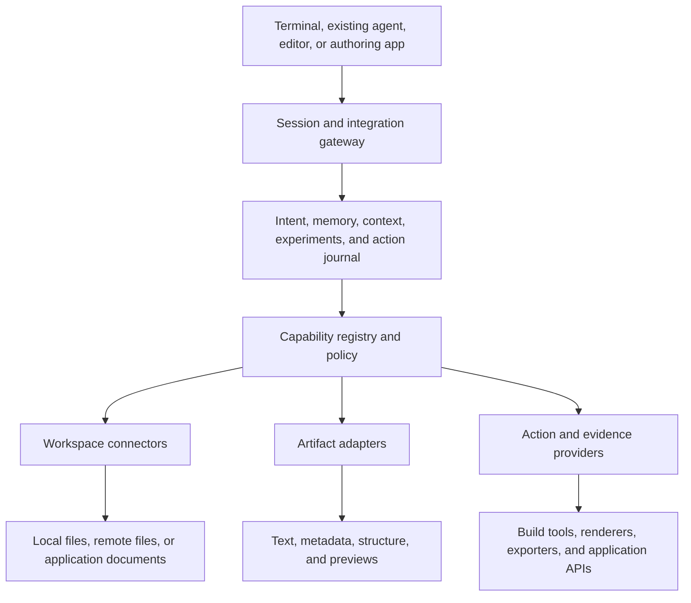

# Environment-agnostic VibeKeep

Status: proposed architecture and migration plan, based on version 0.1.0. Research reviewed on November 14, 2026. Future capabilities in this document are not implemented features unless explicitly identified as current behavior.

## 1. Product scope

VibeKeep should preserve intent, decisions, experiments, context, and evidence wherever a person creates with an AI agent: code in any language, visual design, documents, notebooks, games, 3D scenes, automation, and mixed projects.

The core must not require a particular programming language, package manager, build system, editor, repository, or authoring application. A project becomes a collection of connected workspaces and artifacts, rather than necessarily a Git repository containing an application.

Environment independence means a stable core with extensible connectors and explicit capabilities. An integration still needs an accessible interface: files, a supported protocol, an API, an application plugin, or an explicitly configured automation bridge. A closed environment without an accessible interface can participate only through available exports or user-supplied observations. No universal connector can bypass missing interfaces or permissions.

Node.js is currently a dependency of the VibeKeep runtime. A Java project must not need JavaScript, npm, or a `package.json`. A design document must not need to become a code repository. An application or editor client could contact a VibeKeep service running elsewhere instead of installing Node.js in the target environment.

Repository documentation and product text remain in English. Development discussions follow the user's conversation-language preference.

## 2. What exists today and what must change

| Concern | Version 0.1.0 | Planned direction |
|---|---|---|
| Entry point | Own terminal chat and commands in `src/cli.ts` | Keep the CLI; add a service interface and optional clients for existing agents and applications. |
| Workspace | A local directory resolved with `realpathSync` | Connector-provided identities; local paths are one backend. |
| Discovery | Text files, `package.json` details, and a small manifest marker list in `src/repo.ts` | Domain-neutral artifact discovery plus optional ecosystem detectors. |
| Resource model | `FileFact` with path, hash, and byte count in `src/types.ts` | Stable identity, representation, revision, access, and supported operations. |
| Assets | Binary files omitted; 256 KiB per-file text limit | Discover binary/native assets as metadata; inspect or mutate them only through a suitable adapter. |
| Execution | Authorized npm scripts in `Executor.runScript` | Generic registered actions; npm becomes one provider. |
| Context | Prompt assumes source files and npm checks in `src/agent.ts` | Context based on available resources, capabilities, and appropriate evidence. |
| Memory | SQLite, FTS5, decisions, provenance, and events in `src/store.ts` | Preserve this foundation and add references to workspaces, artifacts, revisions, and experiments. |
| Scope | Git branch or the fallback `workspace` string | Explicit scopes optionally bound to branches, native document versions, or experiments. |
| Recovery | Snapshots of own text writes | Per-operation recovery: restore, compensate, manual recovery, or unavailable. |
| Verification | Process result linked to an inventory fingerprint | Typed evidence: compilation, export, structure checks, preview observations, or user acceptance. |

Java source and SVG files can already be read and edited as text if they pass current limits. Maven/Gradle execution, native design-document editing, remote workspaces, and semantic understanding of those formats are not implemented. Adding a manifest filename improves discovery only; it does not implement execution or validation.

## 3. Architecture: four independent extension points



### Host integration: where the conversation happens

The current CLI remains one client. Other clients may include an editor extension, an MCP host, an authoring-app plugin, or a web interface.

The user can keep their usual chat when it has a supported VibeKeep integration. In memory-service mode, the host provides the agent/model and calls VibeKeep tools. VibeKeep's own model credentials are needed only for its standalone agent runtime. A second chat is not an architectural requirement.

A host connector reports what it can observe: messages, selections, tool results, resource changes, or none of these. MCP alone does not capture arbitrary host conversations or force an agent to use memory tools. Missing observation is recorded as a gap, not invented intent. [MCP architecture](https://modelcontextprotocol.io/docs/learn/architecture).

### Workspace connector: where the work lives

A connector lists resources, resolves identities, obtains revisions, reads supported representations, and observes changes. Initial connectors wrap local files and optional Git information. Later connectors can access remote files or native application documents.

One project can attach multiple workspaces without copying everything into one directory. A Java backend, a design document, and an asset folder can share related decisions while retaining separate identities and permissions.

### Artifact adapter: what can be understood and changed

Adapters interpret resources such as Java source, Markdown, SVG, images, design nodes, notebook cells, or scene objects. They expose supported representations: metadata, text, structure, or preview.

An opaque binary file must never be decoded and overwritten through a text-editing tool. An unknown artifact can still be listed and referenced without pretending that its contents are understood. Reading a preview is not the same capability as editing its source.

### Action and evidence provider: what can be done and checked

Providers implement operations such as running a test task, rendering a preview, changing a node property, exporting an asset, or executing a notebook cell. npm, Maven, a renderer, and an application plugin implement the same core action contract with different operations.

The core handles authorization, preconditions, journaling, results, and recovery status. Tool-specific commands and validation belong to the provider. Profiles compose adapters as conveniences, not as a closed list of supported project types. A workspace can match several profiles or use generic capabilities without any profile.

## 4. Shared resource and capability contracts

Proposed contracts, not implemented exports:

```ts
type ResourceRef = {
  projectId: string;
  workspaceId: string;
  resourceId: string;
  revision: string | null;
};

type Artifact = {
  ref: ResourceRef;
  kind: string;
  mediaType?: string;
  representations: Array<'metadata' | 'text' | 'structure' | 'preview'>;
  capabilities: string[];
};

type Capability = {
  id: string;
  providerId: string;
  operation: string;
  inputSchema: object;
  availability: 'available' | 'missing_dependency' | 'disconnected' | 'unsupported';
  permission: 'granted' | 'requires_authorization' | 'denied';
  recovery: 'restore' | 'compensate' | 'manual' | 'none';
};

type Evidence = {
  actionId: string;
  subject: ResourceRef[];
  kind: string;
  outcome: 'passed' | 'failed' | 'not_run' | 'inconclusive';
  observationRef: string;
};
```

The registry also tracks schema versions, connector identities, operation limits, and discovery evidence. Discovery, runtime availability, permission, and successful execution are separate concepts. A single `supported: true` flag is insufficient.

A revision can be a content hash, application version token, or connector-supplied revision. If no reliable revision is available, expose the uncertainty and re-inspect before mutation. Binary discovery should use bounded metadata or streaming hashes, with explicit partial observations; the existing text limits must not silently become universal asset limits.

Action requests reference registered capabilities and resource identities. Provider inputs are validated JSON, not unrestricted shell text inferred from a README. A native adapter may run in another language and communicate through a versioned protocol without importing the TypeScript runtime.

## 5. Practical examples

| Environment | Adoption and context | Changes | Suitable evidence |
|---|---|---|---|
| Java with Maven or Gradle | Sources, build metadata, modules, existing conventions | Text edits and Java-provider tasks | Actual compile/test results tied to source revisions |
| Local design folder | Briefs, SVG, tokens, image metadata, references | SVG/token edits; image operations through an editing provider | Structural validation, rendered previews, export results, and user review |
| Native design application | Document identity, selected nodes, properties, revisions, previews | Bounded application-API operations | Updated node state, preview observations, and user acceptance |
| Notebook | Cells, metadata, outputs, kernel/session identity when connected | Cell edits and authorized kernel execution | Actual execution results and data/session revisions |
| 3D or another authoring app | Scene/document resources exposed by its adapter | Supported scene or document operations | Render/export results and domain-specific inspection |
| Mixed/remote project | Several connected workspaces with separate revision schemes | Each operation runs in its correct environment | Evidence linked to the relevant resources and connector |

### Java

Discover `.java` files and Maven/Gradle metadata, preserve the build system, and use the generic text adapter for sources. A Java provider checks JDK/build-tool availability and offers authorized tasks. A project without a compatible JDK still supports memory and source inspection; it is not described as successfully tested.

Maven's POM/lifecycle and the Gradle wrapper provide real integration points. Wrappers and build files remain project code, may download dependencies, and are not executed merely because they were detected. No npm manifest is required. [Maven guide](https://maven.apache.org/guides/getting-started/index.html), [Gradle wrapper](https://docs.gradle.org/current/userguide/gradle_wrapper.html).

### Local design and native design applications

A design-only folder can work without Git, a build command, or tests. Memory preserves choices about composition, color, spacing, and rejected alternatives. SVG or token JSON can use text/structure adapters; native image editing needs a suitable editing provider. A successful export does not prove that a design satisfies the user.

For a design application, attach to a document and selection, retrieve stable node references, apply a supported operation, and inspect the resulting revision. Recovery uses supported application operations or adapter snapshots. A global undo command cannot be assumed to undo exactly VibeKeep's change in a collaborative document.

For Figma, general canvas mutations would use the Plugin API or another verified write-capable connector. Do not advertise the REST API alone as a general canvas editor. The Plugin API supports editor read/write access with documented limits. This is a planned integration, not a repository feature today. [Figma Plugin API](https://developers.figma.com/docs/plugins/), [Figma REST API](https://developers.figma.com/docs/rest-api/).

### Notebooks, editors, and less accessible tools

Reading `.ipynb` JSON is not a live kernel connection. A notebook adapter must track kernel/session identity and authorized execution using the applicable protocol. [Jupyter messaging](https://jupyter-client.readthedocs.io/en/stable/messaging.html).

Editor integration can use a supported extension API. VS Code documents filesystem, task, custom-editor, notebook, and AI integration surfaces; it is one possible client, not a required editor. [VS Code extension guides](https://code.visualstudio.com/api/extension-guides/overview).

An explicitly configured desktop automation bridge may help when an application has no usable API. Its observability and recovery guarantees are weaker and must be reported. Where no live integration is possible, exports or manual observations provide limited context rather than fabricated native support.

## 6. Memory and verification across domains

Keep the existing distinctions between observations, proposals, explicit acceptance, and superseded decisions. Add references to workspace, artifact, selection, revision, experiment, and evidence.

Examples include preserving a Java public API, retaining a color treatment for a component family, keeping a notebook transformation rule, or aligning a design's labels with backend vocabulary. The memory engine stores these relationships without needing to understand every language or application internally.

Track intent status, implementation state, verification evidence, and user acceptance separately. A design may be visually accepted before export validation. A Java build may pass without satisfying the requested behavior. Verification can be a test, an export, a structural check, a visual observation, or a human review; no single check is mandatory for every domain.

Scopes must not require Git. Stable workspace/experiment IDs can optionally bind to branches or native versions. Do not merge decisions from different resources merely because their display names match. Project-wide intent requires a known project-wide scope.

SQLite can remain the local memory backend or run on the service host. Remote clients should call the service instead of opening an active SQLite WAL file over a network filesystem. [SQLite WAL limitations](https://www.sqlite.org/wal.html).

## 7. Adoption and user experience

Adoption becomes:

`attach workspace → discover artifacts → describe available capabilities → collect baseline observations → build relevant context`

The interaction remains:

`express intent → make a small change → observe the result → react → update memory`

Neither loop requires a package installation, tests, build command, preview server, Git, or a second chat. The environment determines which capabilities are useful. Missing capabilities do not block unrelated memory and inspection work.

In remote operation, the service can run near the resources or delegate to an authenticated connector. Access to memory does not imply shell access. Workspace identity, permissions, revisions, and observation gaps remain explicit. Disconnection leaves uncertain actions for reconciliation, not blind replay.

## 8. Migration from the current implementation

| Module | Planned change | Compatibility requirement |
|---|---|---|
| `src/types.ts` | Add workspace, artifact, capability, action, and evidence contracts. | Adapt existing file/package records without discarding stored information. |
| `src/repo.ts` | Extract a local workspace connector and move npm discovery into a detector. | Existing adoption remains available through compatibility views. |
| `src/paths.ts` | Keep path handling local; separate private-data rules from profile-specific generated-output exclusions. | Preserve protection tests; do not hide design source assets because a code profile labels their directory as build output. |
| `src/execution.ts` | Introduce an action dispatcher; move npm execution behind its provider. | Retain `run` and `run_script` as documented aliases during migration. |
| `src/agent.ts` | Generate tools and context from registered capabilities. | Remove universal assumptions about source code, npm, build checks, and browser previews. |
| `src/store.ts` | Add workspace/resource references, explicit scopes, and typed evidence. | Transactional migration, consistent backup, version checks, and fixtures from 0.1 data. |
| `src/cli.ts` | Keep the CLI and add workspace/capability inspection. | Local use must not require deploying a remote service. |
| New integration layer | Versioned service/MCP boundary and host event ingestion. | Document incomplete host observation and actual client guarantees. |

Plan storage migration before introducing new semantics. Preserve decision IDs, provenance, supersession history, and action records. Map old paths to resource identities and branch strings to explicit local scopes. Older clients must reject incompatible schemas instead of guessing.

## 9. Implementation stages

| Stage | Deliverable | Acceptance evidence |
|---|---|---|
| 1. Extract the core | Contracts, local connector, npm provider | Existing CLI tests pass; a non-code folder attaches without npm or Git. |
| 2. Generalize actions | Registry, dispatcher, domain-neutral evidence | A test provider works without `package.json`; unavailable or denied capabilities never invoke tools. |
| 3. Prove a different code ecosystem | Java discovery and a Maven or Gradle provider | A fixture is inspected, changed, and tested using a real compatible JDK/build environment; missing dependencies are reported accurately. |
| 4. Prove a non-code domain | Binary metadata, local design resources, SVG editing, preview provider | A design-only fixture preserves decisions and versions without requiring builds/tests; binary assets never enter text mutation. |
| 5. Decouple the chat | Service boundary and one external host integration | Host memory tools work without a second chat or standalone-agent credentials. |
| 6. Prove native application support | One design-app connector/plugin | Read a selection, apply a bounded change, observe state, and demonstrate advertised recovery. |
| 7. Extend by contract | More language, document, notebook, scene, and remote connectors | Each passes common contract tests plus domain-specific fixtures. |

These are implementation stages, not a process imposed on the user. The service boundary can be designed early while actual application clients come later. Calendar estimates should follow the core extraction and first connector prototype; native application access may substantially affect effort.

## 10. Regression and contract checks

- Existing npm workflows still work after extraction.
- Plain directories support memory/context without Git, manifests, build commands, or tests.
- Java workspaces use Java-provider evidence rather than being mislabeled as npm apps.
- Design workspaces distinguish text, binary metadata, previews, and native revisions.
- Read-only connectors never advertise mutation or recovery operations.
- Unknown artifacts remain discoverable without fabricated interpretation.
- Changed resources invalidate dependent evidence, including native application changes.
- Authorization for one workspace cannot implicitly target another.
- Observation gaps never become inferred user acceptance.
- Host-service mode uses the host model without requiring standalone VibeKeep credentials.
- Concurrent edits, interrupted operations, and disconnects retain uncertain outcomes without blind retries.
- Memory migration preserves existing decision IDs and provenance.

## 11. Immediate decision

Version 0.1.0 remains a local terminal agent with text-file tools, memory, and npm execution. It is the first implementation to extract behind adapters, not the definition of all environments VibeKeep should support.

The next code change should establish the extension contracts and move existing behavior behind them. Java and a design-only folder are independent acceptance cases for the new architecture. Expanding a technology list alone does not establish environment independence.
